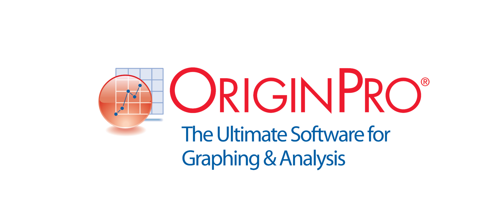
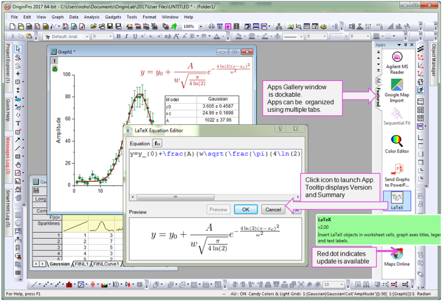

# OriginPro for Scientific Graphing and Data Analysis

OriginPro brings data import, scientific plotting, curve fitting, and statistical tools into one Windows workspace.
This independent repository organizes practical notes and official Python examples for working with the application.

[](https://originpro-learning-edition.github.io/OriginPro-Graphing/)

For readers exploring **OriginPro Learning Edition**, the examples connect familiar worksheet tasks with Python automation.
**OriginPro Graphing** workflows can begin with an interactive plot and develop into a reusable analysis routine.

## Documentation

OriginLab OriginPro combines worksheets, matrix sheets, graphs, and analysis reports in a project.
The OriginPro software supports interactive work alongside scripting, so repetitive steps can be automated progressively.
An Origin Pro lab workflow benefits from keeping measurement labels, units, processing choices, and results together.

The files collected here are examples from OriginLab's Python-Samples repository.
They demonstrate integration with the application through the `originpro` package.
They are separate from the proprietary application and require a suitable Origin installation.

Use the [Origin Python documentation](https://www.originlab.com/doc/python/Run-Python-in-Origin) for the embedded interpreter.
The [originpro API reference](https://www.originlab.com/python/doc/originpro/index.html) describes the available objects and methods.
For external Python, consult the [external Python documentation](https://www.originlab.com/doc/ExternalPython) because interpreter integration differs.

## Features of package

| Workflow | Application tools | Useful result |
| --- | --- | --- |
| Prepare measurements | Worksheets, column labels, and import connectors | Data with a documented structure |
| Explore relationships | Scatter, line, and grouped plots | A visual comparison of measurements |
| Work with grid data | Matrix sheets, heatmaps, and surface plots | A spatial view of measured or calculated values |
| Estimate model parameters | Linear and nonlinear fitting | Parameters with supporting fit reports |
| Examine peaks | Peak analysis and fitting tools | A structured comparison of peak characteristics |
| Process repeated inputs | Templates, recalculation, and batch processing | Consistent treatment of multiple datasets |
| Automate routine work | Embedded Python and the originpro package | Repeatable data and graph operations |

Choose the data structure before choosing the graph.
Column-oriented measurements usually belong in a worksheet.
A regularly sampled grid is often easier to handle as a matrix with a defined coordinate mapping.

Keep raw measurements distinct from transformed values.
A clear column name should explain whether a series is measured, normalized, smoothed, or calculated.
Store units with the columns so that a later graph has enough context to be interpreted.

## Input and output

Import settings influence every later calculation.
Check delimiters, decimal notation, header rows, and column assignments before applying the same process to many files.
For spreadsheet sources, also confirm the selected sheet and imported range.

The included import examples cover several common cases:

- [Import CSV with Auto Settings.py](2.%20Worksheet/Import%20CSV%20with%20Auto%20Settings.py) uses a worksheet data connector for text input.
- [Import Excel Sheet.py](2.%20Worksheet/Import%20Excel%20Sheet.py) demonstrates spreadsheet selection and partial import settings.
- [Import Using a Filter.py](2.%20Worksheet/Import%20Using%20a%20Filter.py) applies a previously prepared import filter.

Python can also supply values directly, which is useful when data already exists in a script.
The following original example creates a small worksheet inside Origin's embedded Python environment.

```python
import originpro as op

times = [0, 1, 2, 3, 4]
response = [0.4, 1.1, 1.9, 2.8, 3.5]
wks = op.new_sheet()
wks.from_list(0, times, lname="Elapsed Time", units="s", axis="X")
wks.from_list(1, response, lname="Response", units="V", axis="Y")
print(wks.shape)
```

The lists represent illustrative values, and each column receives a name, unit, and axis designation.
Use the same pattern to transfer calculated series while preserving their meaning.

For more data-exchange patterns, inspect:

- [Putting Data to Columns.py](1.%20Origin-Python%20Data%20Exchange/Putting%20Data%20to%20Columns.py) for column values and metadata.
- [DataFrame and Column Format.py](1.%20Origin-Python%20Data%20Exchange/DataFrame%20and%20Column%20Format.py) for pandas exchange and column formatting.
- [Matrix Data Exchange.py](1.%20Origin-Python%20Data%20Exchange/Matrix%20Data%20Exchange.py) for transferring NumPy arrays to and from matrix sheets.

A DataFrame and a matrix encode different assumptions about the data.
Check dimensions and labels after transfer instead of assuming that a successful import establishes the intended structure.

## Plotting features

A readable graph should communicate the measurement and comparison before emphasizing decoration.
Start with meaningful axis titles, units, and a suitable scale.
Use a legend when the reader needs to distinguish multiple datasets.

To plot the worksheet from the previous example, run this continuation in the same Python session.
It creates a scatter graph and adjusts the axes to the plotted range.

```python
graph = op.new_graph(template="Scatter")
layer = graph[0]
plot = layer.add_plot(wks, coly=1, colx=0)
layer.rescale()
plot.color = op.ocolor("Blue")
layer.set_int("x.showgrids", 1)
layer.set_int("y.showgrids", 1)
```

For multiple series, use both visual styling and descriptive labels.
When preparing a group of figures, keep axis conventions and legend placement consistent.

The graph examples provide practical references for these tasks:

- [Customizing Graph.py](4.%20Graphing/Customizing%20Graph.py) changes plot styling and layer properties.
- [Customize Legend.py](4.%20Graphing/Customize%20Legend.py) adjusts legend appearance and position.
- [Multiple Layer Plot.py](4.%20Graphing/Multiple%20Layer%20Plot.py) combines worksheet data across graph layers.
- [Line Plot with Log Scale.py](4.%20Graphing/Line%20Plot%20with%20Log%20Scale.py) illustrates logarithmic scaling for a calculated spectrum.

A logarithmic axis changes how distances represent numeric differences.
Check the data range and the meaning of zero before using that scale.

For gridded data, verify how matrix indices correspond to physical coordinates.
A heatmap needs a meaningful color scale, while a surface plot also needs a clear viewing perspective.

- [Plot Heatmap from Matrix.py](3.%20Matrix/Plot%20Heatmap%20from%20Matrix.py) maps matrix values into a heatmap.
- [3D Parametric Plot From Matrix.py](3.%20Matrix/3D%20Parametric%20Plot%20From%20Matrix.py) builds a parametric surface using NumPy arrays.



## Extending

Python automation is useful when the same data preparation or analysis must be repeated.
Begin with one inspected dataset, confirm the result interactively, and then generalize the sequence.
Keep model selection and processing assumptions visible in the script.

This independent example fits a straight line to illustrative measurements.
Run it in Origin's embedded Python environment to create the worksheet and fitting report.

```python
import originpro as op

fit_sheet = op.new_sheet()
fit_sheet.from_list(0, [0, 1, 2, 3, 4], lname="Time", units="s", axis="X")
fit_sheet.from_list(1, [1.0, 2.9, 5.2, 6.8, 9.1], lname="Signal", axis="Y")
linear = op.LinearFit()
linear.set_data(fit_sheet, 0, 1)
report_range, curve_range = linear.report(3)
print(report_range, curve_range)
```

The report and fitted-curve ranges identify generated outputs for later inspection.
Review the model assumptions, residual behavior, and parameter uncertainty before interpreting a fit.

The supplied analysis examples extend this pattern:

- [Linear Regression and Plot.py](5.%20Analysis/Linear%20Regression%20and%20Plot.py) combines regression output with plotted data and bands.
- [Simple Curve Fit to XY Data.py](5.%20Analysis/Simple%20Curve%20Fit%20to%20XY%20Data.py) retrieves nonlinear fit parameters and statistics.
- [Batch Fitting Multiple Data Files.py](5.%20Analysis/Batch%20Fitting%20Multiple%20Data%20Files.py) processes several inputs and collects fitted results.

For batch work, keep a record of which source produced each result row.
A failed import or fit should remain visible rather than being mistaken for a valid empty result.
Test the routine with representative inputs before applying it to a larger collection.

Project organization and export are also part of repeatable analysis:

- [Manage Project Explorer.py](7.%20Miscellaneous/Manage%20Project%20Explorer.py) demonstrates project folders and workbook creation.
- [Export Graphs as Images from Sample Projects.py](7.%20Miscellaneous/Export%20Graphs%20as%20Images%20from%20Sample%20Projects.py) demonstrates image export from an existing project.

Use explicit output names when adapting export scripts.
Check the exported figure at its intended display or print size.

## Platforms

OriginPro is a Windows application.
The embedded Python examples operate through the installed application and its available features.
An external Python interpreter requires the supported Origin integration described in the vendor documentation.

Some supplied scripts also require packages such as NumPy, pandas, or SciPy.
Review each script's imports and comments when selecting an example.
Learning Edition availability and license conditions should be checked with OriginLab for the intended user.

## License

OriginPro is proprietary software distributed under OriginLab's license terms.
The Python examples retain the licensing and attribution supplied by their upstream repository.
This independent collection does not replace the application or provide an OriginPro license.

## Related Search Terms

OriginPro Learning Edition, OriginPro Graphing, originlab originpro, originpro software, origin pro lab, data-analysis, data-visualization, scientific-plotting, plotting, curve-fitting, peak-detection, python, originpro, originlab, data-science
